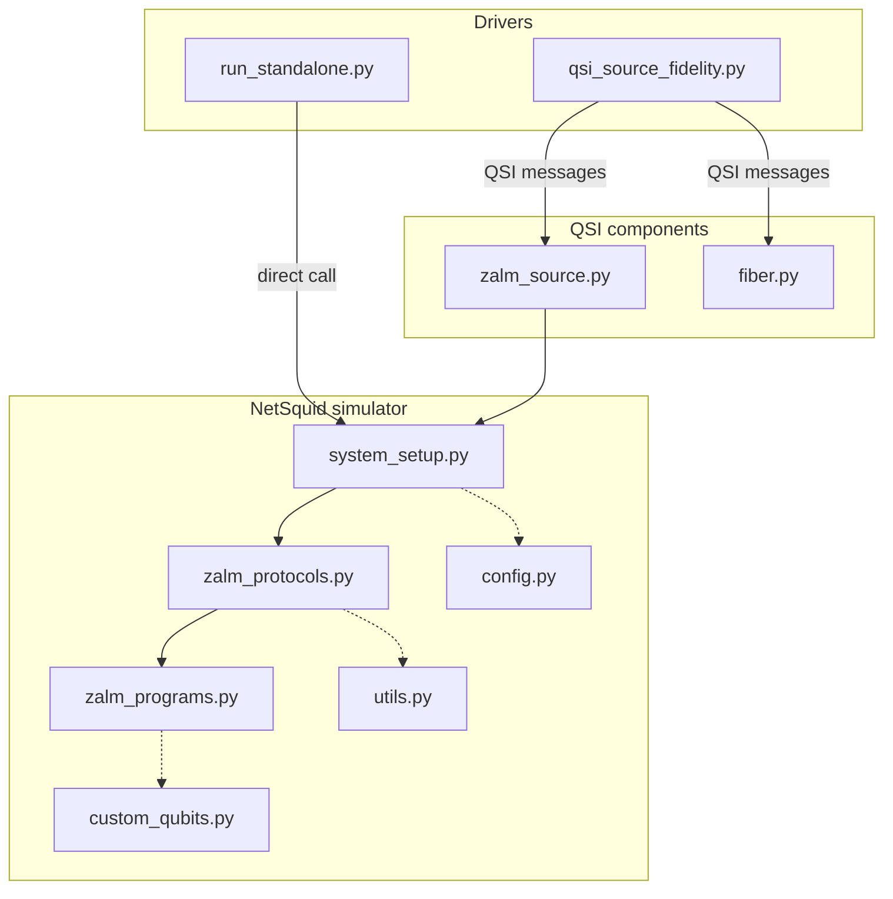

# ZALM Source Simulation

[](https://doi.org/10.5281/zenodo.23966133)
[](https://doi.org/10.1002/qute.202500810)

Discrete-event simulation of a **Zero-Added-Loss Multiplexing (ZALM)** entangled-photon
source, built on [NetSquid](https://netsquid.org). This is the code and data behind:

> J. Horgan, A. Nico-Katz, S. L. Jenkins, A. N. Tittelbaugh, V. Vasan, R. Bali, M. Ruffini, B. A. Bash, D. C. Kilper,
> "A Zero-Added-Loss Multiplexing (ZALM) Source Simulation", *Advanced Quantum Technologies* (2026),
> doi:[10.1002/qute.202500810](https://doi.org/10.1002/qute.202500810)

Two SPDC sources, a 50:50 beamsplitter, polarising beamsplitters, DWDM filters and a heralding
Bell-state measurement are modelled as NetSquid nodes. Each run triggers the source once and
reports whether a pair was heralded, plus the two-photon density matrix. Over many runs the
simulator gives the **heralding probability** and the **fidelity to |Ψ⁻⟩** as functions of detector
efficiency, SPDC degeneracy bandwidth, photon bandwidth and timing jitter.

> **Status:** this repository is the archived artifact for the paper above and is not under
> active development. Its successor is HERMES, which supersedes this code.

The simulator runs in two modes:

| Mode | Driver | Needs | Use it for |
|---|---|---|---|
| **Standalone** (recommended) | `run_standalone.py` | NetSquid | Running the source model, parameter sweeps, reproducing the figures |
| **QSI** | `qsi_source_fidelity.py` | NetSquid + [QSI](https://github.com/tqsd/special_issue_quantum) | Re-running the exact pipeline used for the paper, or composing the source with other QSI components |

For every result in the paper, the QSI fibre components are set to 0 km and their channel is the
identity. Distance is modelled inside NetSquid through `INTERNODE_LENGTH`. Both modes therefore
produce statistically identical results.

---

## Repository layout

```
config.py                 All physical / simulation parameters (UPPERCASE globals)
system_setup.py           Builds the NetSquid network (nodes, channels) and wires the protocols
zalm_protocols.py         Node protocols: SPDC, beamsplitter, PBS, filters, heralding, measurement
zalm_programs.py          NetSquid quantum programs run on the node processors
custom_qubits.py          FlyingQubit: a qubit carrying frequency / polarisation metadata
utils.py                  DWDM grid, HOM visibility, processor factory, helpers

run_standalone.py         Standalone driver (NetSquid only)
sweep_standalone.sh       Sweep any config parameter with the standalone driver

zalm_source.py                 QSI component wrapping the simulator
fiber.py                       QSI fibre component (loss + phase Kraus operators)
qsi_source_fidelity.py         QSI driver for the source sweeps (Figs 7-12)
qsi_source_fidelity_distance.py  QSI driver for the distance sweeps (Figs 13-15)
qsi_distance_vs_fidelity.py    The distance script named in the paper (sweeps the QSI fibre length in one process)
qsi_sweeps/                    The original QSI sweep scripts used for the paper

paper_data/                    JSON results behind Figs 7-15 + the scripts that plot them
```



---

## Installation

Requires Python 3.12 (tested on macOS arm64 and Ubuntu 24.04 x86_64).

NetSquid is **not on PyPI**. Register for a free account at <https://netsquid.org>, then:

```bash
python3.12 -m venv .venv
source .venv/bin/activate
pip install --extra-index-url https://<netsquid-user>:<netsquid-password>@pypi.netsquid.org netsquid==1.1.8

pip install -r requirements.txt        # standalone mode
pip install -r requirements-qsi.txt    # QSI mode (adds the QSI package)
```

---

## Mode 1: Standalone (NetSquid only)

```bash
# 10,000 source triggers using the parameters in config.py, on 8 CPU cores
python run_standalone.py --runs 10000 --workers 8 --out baseline.json

# Override any config.py parameter without editing the file (repeatable)
python run_standalone.py --runs 10000 --workers 8 \
    --set DETECTOR_TYPE=PNR --set DETECTOR_EFFICIENCY=0.9 --out pnr_0.9.json

# Reproducible run
python run_standalone.py --runs 10000 --workers 8 --seed 42
```

Options: `--runs`, `--workers`, `--chunk` (runs per worker process, default 500), `--seed`,
`--set KEY=VALUE`, `--no-processor-delays`, `--label`, `--out`. Run `python run_standalone.py -h` for details.

**Parameter sweeps.** `sweep_standalone.sh` sweeps one parameter and writes one JSON per value to
`results/<PARAM>/`. It does not modify `config.py`:

```bash
./sweep_standalone.sh TEMPORAL_JITTER_STDEV_PS 0 0.5 20 --runs 10000 --workers 8    # SPDC jitter (ps)
./sweep_standalone.sh DETECTOR_EFFICIENCY 0.15 0.05 1.0 --runs 10000 --workers 8    # detector efficiency
./sweep_standalone.sh SPDC_DEGENERACY_BANDWIDTH_FWHM_NM 0.2 0.2 5.0 --runs 10000 --workers 8
./sweep_standalone.sh PHOTON_FWHM_GHZ 5 5 100 --runs 10000 --workers 8
./sweep_standalone.sh INTERNODE_LENGTH 0 1 50 --runs 10000 --workers 8              # distance (km per arm)
```

`INTERNODE_LENGTH` is the fibre length on **each** side of the source. The link is symmetric, so
the end-to-end distance is twice this value. Loss is 0.2 dB/km through NetSquid's `FibreLossModel`.

Throughput is roughly 1,000 runs/s on 8 Apple-silicon cores, so a 10,000-run point takes about 10 s.

## Mode 2: QSI (as used for the paper)

`qsi_source_fidelity.py` starts a QSI `Coordinator`, which launches `zalm_source.py` and two
`fiber.py` instances as separate processes and exchanges JSON messages with them. For each run,
the source returns the heralded two-photon density matrix. Each photon is then passed through a
fibre channel, and the fidelity to |Ψ⁻⟩ is computed.

```bash
python qsi_source_fidelity.py
```

The run count (`num_runs`), QSI fibre length (`dist_km`, 0 for the paper), and output name
(`run_type` / `run_value`) are set inside the script. The original sweeps live in `qsi_sweeps/`
and **must be run from the repository root**:

| Script | Sweeps | Driver |
|---|---|---|
| `qsi_sweeps/run_degeneracy_sweep.sh` | `SPDC_DEGENERACY_BANDWIDTH_FWHM_NM` | `qsi_source_fidelity.py` |
| `qsi_sweeps/run_photon_fwhm_sweep.sh` | `PHOTON_FWHM_GHZ` | `qsi_source_fidelity.py` |
| `qsi_sweeps/run_photon_jitter_sweep.sh` | `TEMPORAL_JITTER_STDEV_PS` | `qsi_source_fidelity.py` |
| `qsi_sweeps/run_det_efficiency_sweep.sh` | `DETECTOR_EFFICIENCY` | `qsi_source_fidelity.py` |
| `qsi_sweeps/run_distance_sweep.sh` | `INTERNODE_LENGTH` 0–50 km | `qsi_source_fidelity_distance.py` |

These scripts edit `config.py` (and `qsi_source_fidelity.py`) in place with `sed -i ''`. That is
macOS/BSD syntax; on Linux use `sed -i`. Run `git checkout config.py qsi_source_fidelity.py`
afterwards. The output prefix in `qsi_source_fidelity.py` (`run_type = f"DEFAULT_DET_EFF_{run_value}"`)
was edited by hand for each sweep. Each sweep point runs in a separate process; the memory note below explains why.

---

## Reproducing the paper figures

`config.py` ships with the paper's **default (REALISTIC) configuration** from Section 4.1:
5 nm SPDC degeneracy, 30 GHz photons, 0 ps jitter, STANDARD detectors at 98 % efficiency, DICHROIC
mode, a 100 GHz Gaussian DWDM grid, and `INTERNODE_LENGTH = 1e-5` km. Every figure varies one or two
parameters away from this baseline.

The aggregated results behind each figure are in `paper_data/`:

| Fig. | Folder | What varies | Standalone equivalent | Plot (run inside `paper_data/`) |
|---|---|---|---|---|
| 7 | `run_source_fildelity_degeneracy/` | degeneracy 0.2–5.0 nm | `sweep_standalone.sh SPDC_DEGENERACY_BANDWIDTH_FWHM_NM 0.2 0.2 5.0` | `python plot_source_fidelity_degeneracy.py` |
| 8 | `run_source_fildelity_photon_bandwidth/` | photon FWHM 5–100 GHz | `sweep_standalone.sh PHOTON_FWHM_GHZ 5 5 100` | `python plot_source_fidelity_photon.py` |
| 9 | `run_source_fildelity_photon_jitter/` | SPDC jitter 0–20 ps | `sweep_standalone.sh TEMPORAL_JITTER_STDEV_PS 0 0.5 20` | `python plot_source_fidelity_jitter.py` |
| 10 | `run_source_fildelity_detector_efficiency/` | detector efficiency | `sweep_standalone.sh DETECTOR_EFFICIENCY 0.15 0.05 1.0` | `python plot_source_fidelity_efficiency.py` |
| 11 | `run_source_fildelity_mode_detector/` | `SPDC_MODE` × `DETECTOR_TYPE` | `run_standalone.py --set SPDC_MODE=PBS --set DETECTOR_TYPE=PNR` (×4) | `cd run_source_fildelity_mode_detector && python plot_json_results.py` |
| 12 | `source_configurations/` | IDEAL, DM/PBS, 1/5 nm, STD/PNR | as Fig 11, plus `SIM_MODE='IDEAL'` in `config.py` | `cd source_configurations && python plot_json_results.py` |
| 13 | `run_performance_vs_length_IDEAL_NS_fibre_Loss_new_model/` | distance, IDEAL mode | `SIM_MODE='IDEAL'`, then `sweep_standalone.sh INTERNODE_LENGTH 0 1 50` | `cd <folder> && python ../plot_performance_vs_length.py` |
| 14 | `run_performance_vs_length_default/` | distance, default | `sweep_standalone.sh INTERNODE_LENGTH 0 1 50` | as Fig 13 |
| 15 | `run_performance_vs_length_DM_1nm_pnr/` | distance, 1 nm + PNR | as Fig 14 `--set SPDC_DEGENERACY_BANDWIDTH_FWHM_NM=1.0 --set DETECTOR_TYPE=PNR` | as Fig 13 |

Figs 7–12 used 10,000 triggers per point; Figs 13–15 used 2,000 per point.
`sweep_standalone.sh` writes the same JSON layout to `results/<PARAM>/`, so the plot scripts
can be pointed at a regenerated folder.

**Check against the paper (standalone mode, current code):**

| Quantity | Paper | `run_standalone.py` |
|---|---|---|
| Default, 0 km: fidelity / ebits per use | ≈0.83 / ≈0.0175 (Fig 9 at 0 ps: 0.826 / 0.0163, 10k runs) | 0.813 ± 0.005 / 0.0146 ± 0.0005 (60k runs) |
| 1 nm + PNR, 0 km (Fig 15) | 0.828 / 0.121 (2k runs) | 0.836 / 0.1206 (20k runs) |

The paper's points come from 2k–10k triggers, of which only about 1.5 % are heralded under the
defaults. They therefore carry roughly ±0.01 statistical uncertainty in fidelity.

---

## Outputs

Each driver writes a JSON summary:

```json
{
  "configuration_name": 9.5,
  "num_trials": 10000,
  "metrics": {
    "fidelity": {"mean": 0.766, "std_dev": 0.12},
    "avg_photon_number": 0.011
  }
}
```

* `fidelity` is ⟨Ψ⁻|ρ|Ψ⁻⟩, averaged over **heralded** runs only. A heralded run is labelled
  `SUCCESS` by `MeasureStationProtocol`, which requires F ≥ 0.5. Runs below that are labelled `FAILURE`.
* `avg_photon_number`, despite its name, is the **heralding probability per trigger**
  (heralded runs ÷ triggers). The name is kept for compatibility with the plot scripts.
* `run_standalone.py` also records `overrides`, `seed`, and a `failure_breakdown`: how many runs
  were lost to emission loss, insertion loss, low HOM visibility, PBS extinction and so on.

---

## Notes

### Quantum-processor delays can be ignored

Every node is modelled as a NetSquid `QuantumProcessor` (see `utils.create_processor`), with
nanosecond instruction durations (INIT 3 ns, H/X/Z 1 ns, CNOT 4 ns, MEASURE 7 ns) and a
1 kHz memory-depolarising rate. These are artefacts of reusing NetSquid's processor abstraction
to manipulate photonic qubits; they do not represent any physical delay in the source. With
`MEMORY_DEPOLAR_RATE = 1e3` Hz, the decoherence they add is about 10⁻⁵. In a seeded 4,000-run
comparison, zeroing all durations changed the mean fidelity only in the fifth decimal place
(0.82654 → 0.82657), with an identical heralding rate. You can disable them in either of two ways:

* `python run_standalone.py --no-processor-delays ...` (no code change), or
* set every `duration=` in `utils.create_processor` to `0`, and/or set `MEMORY_DEPOLAR_RATE = 0` in `config.py`.

### Memory growth and why runs are chunked

NetSquid 1.1.8 never frees `QuantumProcessor` or `QuantumChannel` objects, even after
`ns.sim_reset()`. Because the network is rebuilt for every run (15 processors and about 20 channels),
memory grows by about **0.9 MB per run**: about 1.9 GB after 2,000 runs in one process.
This happens with or without QSI. It is the reason the original QSI sweeps run every
configuration in a separate process. `run_standalone.py` avoids the problem by running
`--chunk` runs (default 500) per worker process and then replacing the worker, which keeps each worker
under about 600 MB however many runs you request.

### `SIM_MODE`

`SIM_MODE = 'IDEAL'` overrides the noise and loss parameters when `config.py` is imported, so it
must be set in the file, not with `--set`.

---

## Citation

If you use this code, please cite the paper above and the software:

> J. Horgan, *ZALM Source Simulation* (software), Zenodo, doi:[10.5281/zenodo.23966133](https://doi.org/10.5281/zenodo.23966133)

That DOI covers all versions and always resolves to the latest one. To cite the exact version
you used, take its own DOI from the Zenodo record. GitHub's **"Cite this repository"** button
(generated from `CITATION.cff`) gives both entries in BibTeX and APA.

## License

GPL-3.0. See `LICENSE`.
